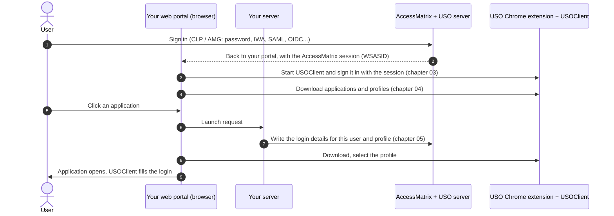

# USO web integration

How to make your web application work with **i-Sprint AccessMatrix Universal Sign-On (USO)**: sign the user
in to the USO server and start USOClient from your own pages, keep USOClient up to date, pass application
login details on the fly when the user launches an application, use several accounts per application, keep
the session alive, and sign out cleanly.

> **Disclaimer.** This is not an official i-Sprint product document and has not been reviewed or approved by
> i-Sprint Product Engineering team. It is provided as is, without warranty, and without any obligation of support,
> testing or regression testing. Read [DISCLAIMER.md](DISCLAIMER.md) before using it.

## What you get

When the integration is done, a user of your web application:

1. signs in once (AccessMatrix, with whatever method you have configured);
2. finds USOClient started and signed in, without visiting the USO portal themselves (or with the USO portal in
   a popup, if you prefer);
3. clicks an application in your portal and has its login filled in by USOClient, with the account your
   application chose, even if the user has never seen that password;
4. can open the same application with different accounts in different windows;
5. stays signed in while working, and is signed out of USOClient when they sign out of your application.

## The flow at a glance

Passwords travel only from your server to the USO server. They never pass through the browser, the URL or
the extensions.

## Chapters

| Chapter | Covers |
|---|---|
| [01. Architecture](docs/01-architecture.md) | The parts, and who talks to whom |
| [02. Prerequisites](docs/02-prerequisites.md) | Versions, the AccessMatrix session (WSASID), page addresses |
| [03. Signing in to USO](docs/03-sign-in-to-uso.md) | With the USO portal in a popup, or directly without a popup |
| [04. Keeping USOClient up to date](docs/04-sync.md) | Forcing an application download; profiles in line with entitlements |
| [05. Launching with login details on the fly](docs/05-launch-with-credentials.md) | One-use launch tickets, server-to-server provisioning, selecting the profile |
| [06. Several accounts per application](docs/06-multiple-accounts.md) | Switching USOClient per window; cookie-based applications and incognito |
| [07. Keeping the session alive](docs/07-keep-alive.md) | AccessMatrix session refresh; keeping USOClient's own session alive |
| [08. Signing out](docs/08-sign-out.md) | The order of operations; what USOClient closes |
| [09. Troubleshooting](docs/09-troubleshooting.md) | Symptoms, checks and logs |
| [10. Optional: client libraries](docs/10-client-libraries.md) | The JavaScript library in this repository; i-Sprint's Java library |

Reference: [browser messages](docs/reference/browser-messages.md) ·
[USO server REST](docs/reference/uso-server-rest.md) ·
[AccessMatrix session REST](docs/reference/accessmatrix-session-rest.md)

Example: [the ARCS demo, step by step](examples/arcs-walkthrough.md)

## The example: ARCS

ARCS is a demonstration web application built to show this integration end to end. While it is online, you
can try it at **https://arcs.ps-demo.i-sprint.com** (demo user `user1`, password `password`); see the
[walkthrough](examples/arcs-walkthrough.md). It is only an example: nothing in this guide depends on
ARCS, and its code is not part of this repository.

## In this repository

| Path | Contents |
|---|---|
| [docs/](docs/) | The guide, with screenshots in `docs/images` |
| [examples/arcs-walkthrough.md](examples/arcs-walkthrough.md) | The ARCS demo, step by step |
| [lib/uso-extension-client.js](lib/uso-extension-client.js) | Optional JavaScript library wrapping the browser messages to USOClient |
| [DISCLAIMER.md](DISCLAIMER.md) | Terms of use |

Related: [Secure Session Launcher](https://github.com/zain-isprint/secure-session-launcher), a Chrome
extension that opens applications in their own windows, handles already-open applications, and cleans up
their sign-in data at sign-out. It works with this integration (chapter 06).
