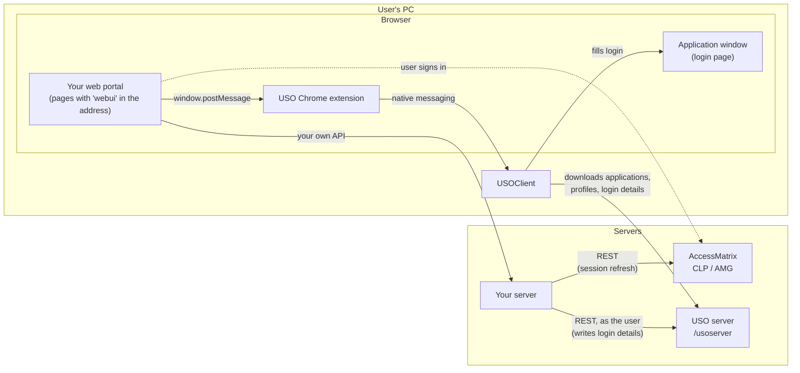

# 01. Architecture

> Not an official i-Sprint document. See [DISCLAIMER.md](../DISCLAIMER.md).

## The parts

| Part | Where it runs | Role in the integration |
|---|---|---|
| **Your web portal** | The user's browser | The pages the user works in: application list, launch page. Talks to USOClient through the USO Chrome extension. |
| **Your server** | Your data centre | Your application's back end. Holds the user's AccessMatrix session and calls the USO server to write login details. |
| **AccessMatrix** | i-Sprint server | Authentication and the user's session (WSASID). Its sign-in page is the Common Login Page (CLP), or the AccessMatrix Gateway (AMG) in newer versions. |
| **USO server** (`/usoserver`) | i-Sprint server | The USO portal (`start.uso`) and the REST API holding each user's applications, profiles and login details. |
| **USOClient** | The user's PC (desktop program) | Recognises application login pages and fills them with the active profile's login details. |
| **USO Chrome extension** | The user's browser | Connects web pages to USOClient (native messaging). |

## Who talks to whom

## Three rules that shape the design

1. **Passwords never go through the browser.** Application login details are written by your server to the
   USO server, server to server, with the user's own session. USOClient downloads them from the USO server.
   The browser only ever handles which application and which profile, never the password.
2. **Only pages USO recognises can talk to USOClient.** The USO Chrome extension relays messages only from
   pages whose address contains `webui` (or the USO portal's `start.uso`). Your portal pages that talk to
   USOClient are opened as, for example, `/portal?webui`.
3. **USOClient and your pages share one AccessMatrix session.** USOClient is signed in with the same session
   token (WSASID) as the user's browser session, so the user signs in once. Your server keeps that session
   alive while the user works (chapter 07).

## What runs where, step by step

| Step | Browser (your pages) | Your server | USO server / AccessMatrix |
|---|---|---|---|
| Sign in | Sends the user to CLP / AMG | | Authenticates; creates the session (WSASID) |
| Start USOClient | Sends USOClient its settings and the session (chapter 03) | Supplies the settings (USOClient server URL, application IDs) | Answers the settings requests |
| Keep USOClient up to date | Asks USOClient to download (chapter 04) | Aligns the user's profiles with their entitlements | Stores profiles |
| Launch | Opens the launch page; selects the profile in USOClient | Writes the login details into the chosen profile (chapter 05) | Stores the login details; USOClient downloads them |
| Work | | Refreshes the session (chapter 07) | |
| Sign out | Signs USOClient out (chapter 08) | Ends its own session | |
