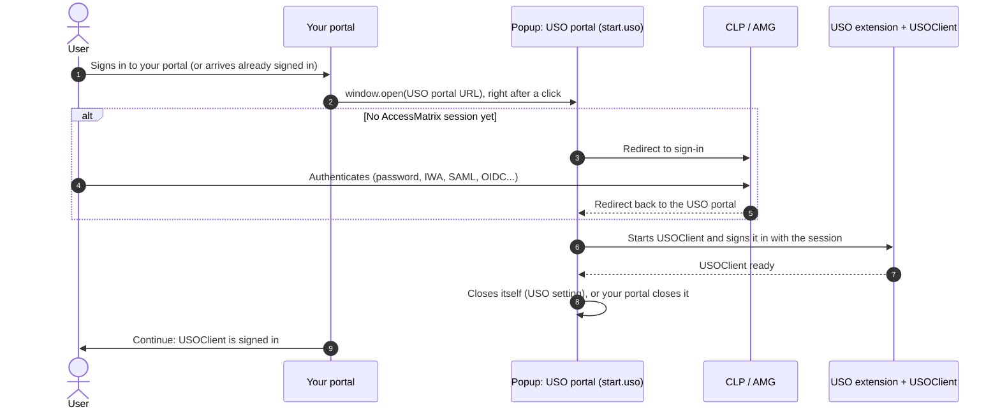
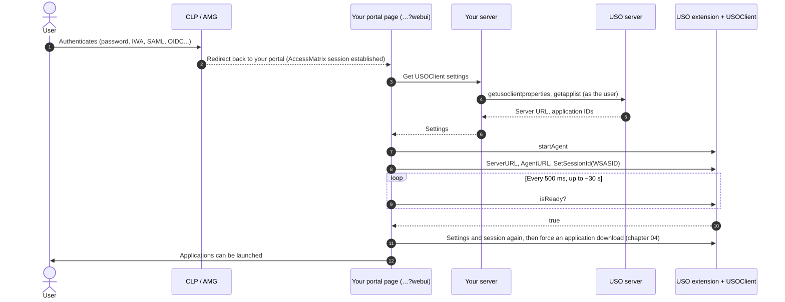

# 03. Signing in to USO

> Not an official i-Sprint document. See [DISCLAIMER.md](../DISCLAIMER.md).

USOClient must be running and signed in to the USO server before it can fill application logins. There are
two ways to get there from your web application:

| | Option A: USO portal in a popup | Option B: directly, without a popup |
|---|---|---|
| After the user signs in | Your portal opens the USO portal in a small popup window | The user stays on your portal |
| Who starts and signs in USOClient | The USO portal | Your portal page |
| What you build | Open the popup; know when it has finished | Send USOClient its settings and the session; wait until it is ready |
| Server work | None for sign-in | Supply USOClient's settings (two USO server calls) |
| User experience | A popup appears briefly at each sign-in | Nothing visible |
| Choose it when | You want the least code, or USO is configured to do extra work in its portal | You want a seamless experience |

Both options start from the same point: the user has signed in to AccessMatrix.

## Signing in to AccessMatrix (common to both)

The USO server's sign-in page is AccessMatrix's **Common Login Page (CLP)**, or the **AccessMatrix Gateway
(AMG)** in newer versions. CLP and AMG support many authentication methods: standard password, IWA, SAML,
OIDC, external authentication and others. Which ones apply, and where CLP/AMG sends the user after a
successful sign-in, are configured in AccessMatrix and are not covered here.

What matters for the integration is the result: the user's browser holds an **AccessMatrix session**
(the `WSASID` cookie, see [chapter 02](02-prerequisites.md#the-accessmatrix-session-wsasid)), and CLP/AMG
redirects the user back to a page you configured:

- in **option A**, back to the **USO portal**, which then starts USOClient;
- in **option B**, back to **your portal**, which then starts USOClient itself.

## Option A: the USO portal in a popup



### Steps

1. **Open the popup from a click.** Browsers allow pop-ups only straight after a user action, so open it in
   the click handler of your sign-in button (or a "Start USO" button), not after an asynchronous call:

   ```js
   var w = 520, h = 640;
   var popup = window.open('https://am.example.com/usoserver/start.uso', 'usoPortal',
     'popup=yes,width=' + w + ',height=' + h +
     ',left=' + Math.round(screenX + (outerWidth - w) / 2) + ',top=' + Math.round(screenY + (outerHeight - h) / 2));
   if (!popup) showMessage('Allow pop-ups for this site, then try again.');
   ```

   If your page has to wait for something first (for example your own sign-in call), open the popup at once
   with a placeholder page of your own, then point it at the USO portal: `popup.location.replace(usoPortalUrl)`.

2. **The USO portal signs the user on.** If the browser already has a valid AccessMatrix session for the USO
   portal's domain, the USO portal signs the user on without asking. Otherwise it redirects to CLP/AMG; after
   the user authenticates, CLP/AMG redirects back to the USO portal.

3. **The USO portal starts USOClient.** It sends USOClient its settings and the session, and USOClient
   downloads the user's applications. Your page does nothing here.

4. **Know when it has finished.** Choose one, depending on how the USO portal is configured:

   | Method | How | Notes |
   |---|---|---|
   | **The popup closes itself** (recommended) | Poll `popup.closed` every 500 ms | Configure the USO portal to close its window once USOClient is active (USO setting "close the USO portal when USOClient is active"). |
   | **The popup reaches a known page** | Poll `popup.location.href` and compare with that page's address | Works only if that page has the same origin (scheme, host and port) as your portal; otherwise the browser does not let you read the popup's address. |
   | **Fixed wait** | Close the popup yourself after N seconds | Simple, but either too long or occasionally too short. |

   Always set a time limit (for example 60 seconds) and then ask the user whether to keep waiting, retry or
   continue without USO. If the user closes the popup before it has finished, offer to retry.

   ```js
   var deadline = Date.now() + 60000;
   var timer = setInterval(function () {
     if (popup.closed) { clearInterval(timer); onUsoReady(); return; }      // closed itself: signed on
     if (Date.now() > deadline) { clearInterval(timer); askKeepWaiting(); }
   }, 500);
   ```

5. **Continue.** USOClient is signed in. Before the first launch, make sure it has the latest applications
   ([chapter 04](04-sync.md)).

### Points to watch

- **One session.** The USO portal signs USOClient in with the browser's AccessMatrix session. If your portal
  refreshes that session ([chapter 07](07-keep-alive.md)), USOClient keeps working: the session is the same,
  only the token changes.
- **Pop-up blockers.** If the popup is blocked, tell the user to allow pop-ups for your portal.
- **Users who skip it.** If a user closes the popup and continues, applications still open but USOClient
  will not fill their logins. Show this clearly, with a way to start USO again.

## Option B: directly, without a popup



### Messages to USOClient

Your page talks to USOClient through the USO Chrome extension with `window.postMessage` on its own window.
The page's address must contain `webui` ([chapter 02](02-prerequisites.md#your-portal-pages)). There are
two kinds of message:

| Kind | Send | Reply |
|---|---|---|
| **Function** | `{ type: 0, func: "<name>", params: [ ... ] }` | None |
| **Invoke** | `{ type: 4, invoke: JSON.stringify({ method: "<name>", params: { ... } }), params: {} }` | A `message` event `{ type: 4, ret: "<JSON {method, result, error}>" }` |

Replies carry only the method name, so keep at most one invoke per method waiting, with a time limit:

```js
function usoCall(func, params) {
  window.postMessage({ type: 0, func: func, params: params || [] }, '*');
}

function usoInvoke(method, params, timeoutMs) {
  return new Promise(function (resolve, reject) {
    function onReply(e) {
      if (e.source !== window || !e.data || e.data.type !== 4 || e.data.ret == null) return;
      var r; try { r = JSON.parse(e.data.ret); } catch (x) { return; }
      if (r.method !== method) return;
      clearTimeout(timer); window.removeEventListener('message', onReply);
      if (r.error != null) reject(new Error(String(r.error))); else resolve({ result: r.result });
    }
    var timer = setTimeout(function () { window.removeEventListener('message', onReply); resolve({ timedOut: true }); }, timeoutMs || 3000);
    window.addEventListener('message', onReply);
    window.postMessage({ type: 4, invoke: JSON.stringify({ method: method, params: params || {} }), params: {} }, '*');
  });
}
```

### Steps

1. **Configure CLP/AMG to return to your portal.** After a successful sign-in, CLP/AMG must redirect the user
   to your portal page (for example `https://portal.example.com/portal?webui`), not to the USO portal. How to
   set the return address depends on your AccessMatrix configuration and authentication method.

2. **Get the session token (WSASID) to the page.** USOClient is signed in with the user's AccessMatrix session
   token. Usually the page reads it from the `WSASID` cookie, which requires the cookie's domain to cover your
   portal and the cookie not to be `HttpOnly`
   ([chapter 02](02-prerequisites.md#the-accessmatrix-session-wsasid)). If your server holds the token instead,
   it can give it to the page in its response.

   ```js
   function readCookie(name) {
     var m = document.cookie.match(new RegExp('(?:^|;\\s*)' + name + '=([^;]*)'));
     return m ? decodeURIComponent(m[1]) : '';
   }
   var wsasid = readCookie('WSASID');
   ```

3. **Get USOClient's settings from your server.** USOClient needs to know which server to talk to, and your
   page needs the user's application IDs. Your server reads them from the USO server, as the user (the
   requests are described in the reference; outline):

   | Setting | From | Request |
   |---|---|---|
   | **USOClient server URL** (`ServerURL`) | USO server | `POST /usoserver/rest/asaservice/getusoclientproperties` with `{"id": "getusoclientproperties"}`; use `value` from the reply |
   | **Agent page** (`AgentURL`) | Your configuration | The USO portal's address, e.g. `https://am.example.com/usoserver/start.uso` |
   | **Application IDs** | USO server | `POST /usoserver/rest/asaservice/getapplist` with `{}`; use `appId` of entries whose `appType` is `S` or `G` |

   USO server requests need, in this order: `GET /usoserver/` once, to receive the `XSRF-TOKEN` cookie; then
   on each call the headers `Authorization: <WSASID>` and `X-XSRF-TOKEN: <XSRF-TOKEN value>`, the
   `XSRF-TOKEN` cookie, and `Content-Type: application/json`. Replies start with an anti-hijacking prefix such
   as `)]}',`: skip everything before the first `{` or `[` before parsing.

   Your server returns the three values to the page; there is nothing secret in them.

4. **Start USOClient and sign it in.**

   ```js
   function usoAgentKey() {
     // USOClient older than 5.5.1.0006 calls the agent page CLPURL. The USO extension sets the usoVersion cookie.
     var v = readCookie('usoVersion').replace(/\s/g, '');
     return !v || v === '99,9,9,9' || v >= '5,5,1,0006' ? 'AgentURL' : 'CLPURL';
   }
   function usoSignIn(settings, wsasid) {
     usoCall('SetUsoRegistryValue', ['ServerURL', settings.serverUrl]);
     usoCall('SetUsoRegistryValue', [usoAgentKey(), settings.agentUrl]);
     usoCall('SetSessionId', [wsasid]);
   }

   usoInvoke('startAgent', {});      // starts USOClient if it is not running
   usoSignIn(settings, wsasid);
   ```

5. **Wait until USOClient is ready.** Ask `isReady` every 500 ms (1.5 s time limit each), for up to about
   30 seconds. If it answers `null` twice, invoke `enableWebUI` once: USOClient may not yet accept this page.

   ```js
   function waitUntilReady(tries) {
     var nulls = 0;
     function next(left) {
       if (left <= 0) return Promise.resolve(false);
       return usoInvoke('isReady', {}, 1500).then(function (r) {
         if (r.result === true) return true;
         if (r.result == null && ++nulls === 2) usoInvoke('enableWebUI', {});
         return new Promise(function (ok) { setTimeout(ok, 500); }).then(function () { return next(left - 1); });
       });
     }
     return next(tries || 60);
   }
   ```

6. **If USOClient never answers, reload the page.** The USO Chrome extension only reaches a USOClient that was
   already running when the page loaded. If USOClient was started by step 4, the page may get no answer at all.
   Reload the page after about 6 seconds without any answer, at most three times (count the reloads in
   `sessionStorage` so it does not loop).

7. **When ready, sign it in again and download.** Send the settings and the session once more (step 4 without
   `startAgent`): a freshly started USOClient may have missed them. Then force an application download
   ([chapter 04](04-sync.md)) before you let the user launch applications.

### The same with the optional library

The JavaScript library [`lib/uso-extension-client.js`](../lib/uso-extension-client.js) does steps 4 to 7:

```js
UsoExtension.startUsoClient({
  serverUrl: settings.serverUrl,          // from your server (step 3)
  agentUrl: settings.agentUrl,
  appIds: settings.appIds,
  session: wsasid,                         // default: the WSASID cookie
  onStatus: function (text) { showStatus(text); }
}).then(function () { enableLaunches(); })
  .catch(function (e) { showError('USOClient could not be started: ' + e.message); });
```

### Points to watch

- **Do not re-send `SetSessionId` later.** Sending it again makes USOClient sign in again, which resets every
  application to its default profile. When the session token is refreshed, keep USOClient alive another way
  ([chapter 07](07-keep-alive.md)).
- **Check that the extension is there.** About 1.5 seconds after the page loads, the USO Chrome extension has
  marked the page with one of the cookies `ChromeExtM3`, `usoClientExt` or `usoNativeHost`. If none is
  present, tell the user that the USO Chrome extension is missing or disabled.
- **Users without USOClient.** If USOClient is not installed, `isReady` never succeeds. Let the user continue,
  with a clear message that logins will not be filled.

## In the ARCS example

ARCS offers both options in its settings ("Start USOClient from: the USO portal, in a popup at sign-in" or
"the ARCS portal (no popup)"). With the no-popup option, ARCS's server obtains the user's AccessMatrix session
itself, then its portal page follows option B exactly as above.
