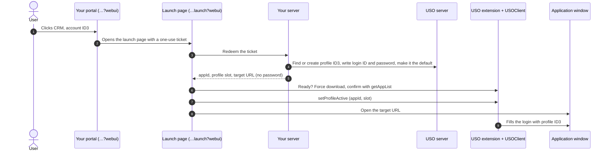

# 05. Launching with login details on the fly

> Not an official i-Sprint document. See [DISCLAIMER.md](../DISCLAIMER.md).

Your application can decide, at the moment the user clicks, **which account** the user signs in to an
application with, and supply **its login details**, even if the user has never seen the password. Your server
writes the login details into the user's USO profile; USOClient downloads them and fills the login page.

**The password never reaches the browser**: not in the launch link, not in the page, not in any extension
message.



## 1. The launch link: a one-use ticket

When your portal shows the user's applications, give each launch button a link to your **launch page** with a
**ticket**: a random, single-use, short-lived identifier that your server maps to "this user, this application,
this account".

```
https://portal.example.com/launch?webui#3f9c2a…
```

- Put the ticket after `#`, so it is not sent to servers or written to logs; the launch page reads it from
  `location.hash` and sends it to your server.
- Make it single-use and short-lived (ARCS: 2 minutes), and tied to the user's session.
- The launch page's address contains `webui`, so it can talk to USOClient
  ([chapter 02](02-prerequisites.md#your-portal-pages)).
- Open it in a new window from the click, so pop-up blockers allow it.

## 2. Server: write the login details

When the launch page redeems the ticket, your server, **as the user** (with the user's WSASID, see the USO
server conventions in [chapter 03](03-sign-in-to-uso.md#steps-1), step 3):

1. **Reads the profiles:** `GET /usoserver/rest/asaservice/getuserappattr?appId=CRM` ([chapter 04](04-sync.md#reading-the-profiles)).
2. **Chooses the slot**, in this order:
   - a profile with the wanted name (case-insensitive): use its slot;
   - else, if the user has one profile still named `Profile 1`: rename it (`renameProfile`) and use slot 1;
   - else: add a profile at slot = count + 1 (`addProfile`) and clear it ([chapter 04](04-sync.md#adding-a-profile)).
3. **Writes the login details** into that slot. First read the slot's other values, so they are kept:

   ```
   GET /usoserver/rest/asaservice/getappinfo?appId=CRM&profileId=3
   → { "userId": "...", "password": "...", "attributes": { ... } }
   ```

   then

   ```
   POST /usoserver/rest/essoservice/resetAppInfo
   { "appId": "CRM", "attributes": { …from getappinfo… }, "profileId": "3",
     "userId": "<application login ID>", "password": "<application password>" }
   ```

4. **Makes it the default profile:**
   `POST /usoserver/rest/essoservice/setProfileActive` `{"appId": "CRM", "profileId": "3"}`.
5. **Answers the launch page** without any password:

   ```json
   { "items": [ { "appId": "CRM", "profileName": "ID3", "slot": 3 } ],
     "appIds": [ "CRM", "HR" ],
     "targetUrl": "https://crm.example.com/login" }
   ```

   `appIds` is the user's full application list, for the forced download.

Where the application password comes from is up to your application: your own vault, a password generated for
this user, or a secret manager.

## 3. Launch page: bring USOClient up to date and select the profile

```js
var ticket = location.hash.slice(1);
history.replaceState(null, '', location.pathname + location.search);   // drop the ticket from the address

redeem(ticket)                                   // your API: returns { items, appIds, targetUrl }
  .then(function (launch) {
    return waitUntilReady(20)                    // chapter 03: isReady, 500 ms apart
      .then(function (ok) {
        if (!ok) throw new Error('USOClient is not ready. Sign in to USO and try again.');
        return forceDownload(launch.appIds, 1500)                 // chapter 04, part 1
          .then(function () { return usoInvoke('getAppList', {}, 4000); });
      })
      .then(function () {
        return launch.items.reduce(function (chain, item) {      // one at a time
          return chain.then(function () {
            return usoInvoke('setProfileActive', { appId: item.appId, profileId: Number(item.slot) }, 4000);
          });
        }, Promise.resolve());
      })
      .then(function () { location.replace(launch.targetUrl); }); // or open it in its own window
  })
  .catch(function (e) { showError(e.message); });
```

- `profileId` in the browser message is the **slot number**, as a number.
- Wait for each `setProfileActive` reply before the next one; replies carry only the method name.
- To open the application in its own window, detect an application that is already open, or clean up its
  sign-in data at sign-out, use the [Secure Session Launcher](https://github.com/zain-isprint/secure-session-launcher)
  extension instead of `location.replace` ([chapter 06](06-multiple-accounts.md)).

With the optional library: `UsoExtension.prepareLaunch(launch, onStatus)` does the readiness check, the forced
download with confirmation, and the profile selection.

## 4. USOClient fills the login

When the application's login page loads, USOClient recognises it (from the application definition in
AccessMatrix) and fills it with the active profile's login details.

## Points to watch

- **Wrong account filled:** the profile selected in the browser must be the one your server just wrote. Check
  that the slot in the answer matches, and that the forced download finished before `setProfileActive`.
- **Old login details:** a newly added profile must be cleared (chapter 04), or a deleted profile's login
  details reappear.
- **The ticket expired:** the user waited too long, or reloaded the launch page; ask them to click again.
- **Several applications in one launch:** `items` may list more than one application (for example a portal
  and its sign-on page); select each profile in turn.

## In the ARCS example

Each ARCS application button is a profile (`Github isprint001`, `Github isprint002`…). The button opens
`launch-wait.html?webui#<ticket>`; the ARCS server writes that profile's login details into the user's USO
profile of the same name, and the launch page selects it before opening GitHub, where USOClient signs in as
`isprint001` or `isprint002`.
