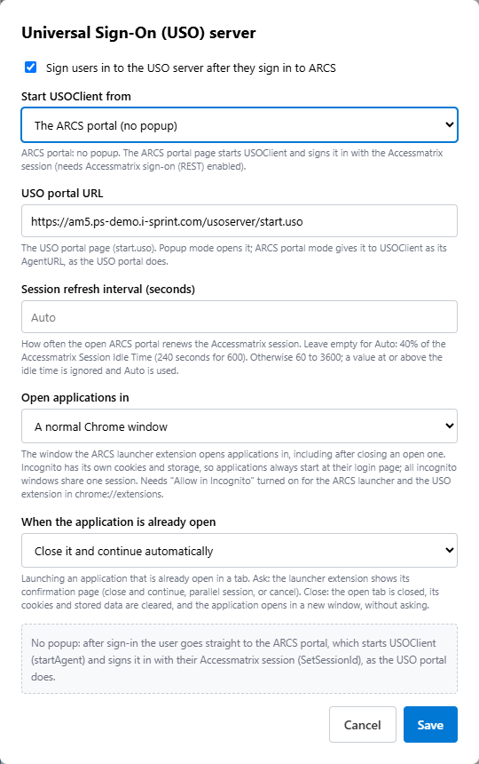

# 06. Several accounts per application

> Not an official i-Sprint document. See [DISCLAIMER.md](../DISCLAIMER.md).

A user can have several profiles (accounts) for the same application, for example a normal account and an
administrator account. USOClient fills a login page with **the application's active profile**, and there is
one active profile per application at a time. This chapter covers switching between them.

## Choosing the account at launch

[Chapter 05](05-launch-with-credentials.md) already selects the right profile at each launch: your server makes
it the default, and the launch page sends `setProfileActive` before the application opens. Launching "CRM as
ID1" and then "CRM as ID2" one after the other works with nothing more.

## Two windows of the same application

The difficulty starts when both windows stay open. After launching "CRM as ID2", USOClient's active profile for
CRM is ID2. If the user goes back to the ID1 window and its session has expired, USOClient would fill the login
there with ID2.

The fix: **whenever the user brings an application window to the front, select that window's profile again**
with `setProfileActive`. Your portal page cannot see which browser window is in front, so this needs a browser
extension. The [Secure Session Launcher](https://github.com/zain-isprint/secure-session-launcher) extension
provides it:

1. Launch through the extension, with the profile as the window's data:

   ```js
   SessionLauncher.launch({
     url: launch.targetUrl,
     app: 'crm',
     data: { uso: launch.items.map(function (i) { return { appId: i.appId, slot: Number(i.slot) }; }) },
     closeRequestingTab: true          // the launch page closes once the application is open
   });
   ```

2. On the portal page, once USOClient is ready, follow the window in front. With the optional library:

   ```js
   UsoExtension.followLaunchedWindows(SessionLauncher);
   ```

   The extension reports each application window the user brings to the front (`window.focused`, with its
   data); the library sends `setProfileActive` for that window's profile when it differs from the one last
   selected. Without the library, do the same in a `window.focused` handler with `usoInvoke` (chapter 03).

The portal page must stay open (it sends the messages to USOClient), with `webui` in its address.

## Applications that keep their sign-in in cookies

Many web applications (GitHub, for example) keep the user's sign-in in cookies, which all normal browser windows
share. Two such windows **cannot be signed in as two different accounts** in the same browser profile: the
second sign-in replaces the first. Options:

| Need | Use |
|---|---|
| Switch account in the same application | Close the open window and clear the application's sign-in data, then launch with the other account. Secure Session Launcher does this ("Close active session & continue", or automatically). |
| Two accounts at the same time | Open the second one in an **incognito** window, which has its own cookies. Secure Session Launcher can do this (`window: 'incognito'`). The **USO Chrome extension must be allowed in incognito** (`chrome://extensions` → Details → "Allow in Incognito"), or USOClient cannot fill the login there. |
| An application that keeps its sign-in per window (in the page itself) | Normal windows work. |

## In the ARCS example

ARCS launches every application through Secure Session Launcher with the USO profile as its data, and its portal
page follows the window in front. ARCS's settings choose whether an already-open application asks the user or is
closed and relaunched automatically, and whether applications open in normal or incognito windows.


