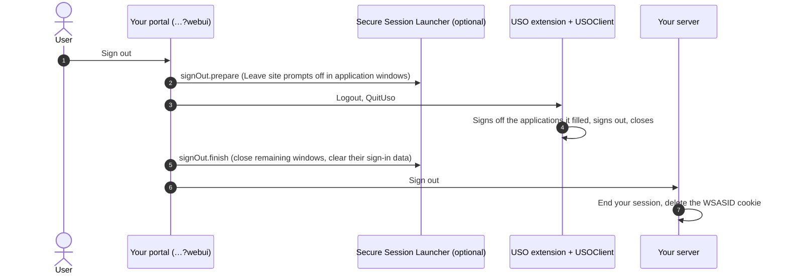

# 08. Signing out

> Not an official i-Sprint document. See [DISCLAIMER.md](../DISCLAIMER.md).

When the user signs out of your web application, sign them out of USOClient too, close the applications they
opened, and end the AccessMatrix session.

## The order



1. **Prepare the application windows** (with Secure Session Launcher): `SessionLauncher.prepareSignOut()`.
2. **Sign USOClient out and close it:**

   ```js
   usoCall('Logout', []);
   usoCall('QuitUso', []);
   // give the extension a moment to pass them on before the page leaves
   setTimeout(continueSignOut, 400);
   ```

   With the optional library: `UsoExtension.logout(400)`.
3. **Close the remaining application windows and clear their sign-in data** (with Secure Session Launcher):
   wait about 1.5 seconds for USOClient's sign-off, then `SessionLauncher.finishSignOut()`.
4. **End the session on your server** and delete the `WSASID` cookie (same name, path and domain, `Max-Age=0`).
   If your AccessMatrix integration offers a sign-out call, make it here.

## What USOClient does at sign-out

At `Logout`, USOClient signs off each application it filled, as configured for that application in
AccessMatrix. For browser applications configured to **sign off gracefully**, USOClient closes the application's
**browser window, with every tab in it**, not only the application's tab.

- If you want only the application tabs closed, and other tabs the user opened in those windows kept, turn off
  graceful sign-off for those browser applications in AccessMatrix, and let Secure Session Launcher close the
  tabs (step 3).
- Keep the order above: signing USOClient out **before** closing the application windows yourself. If an
  application's window is already gone when USOClient signs it off, USOClient may close the browser window in
  front instead, which is often your portal.

## In the ARCS example

ARCS's "Sign out" follows the four steps above. With Secure Session Launcher, the application windows are closed
and the cookies and stored data of every site launched since the last sign-out are cleared, so the next person at
the computer is not signed in to them.
