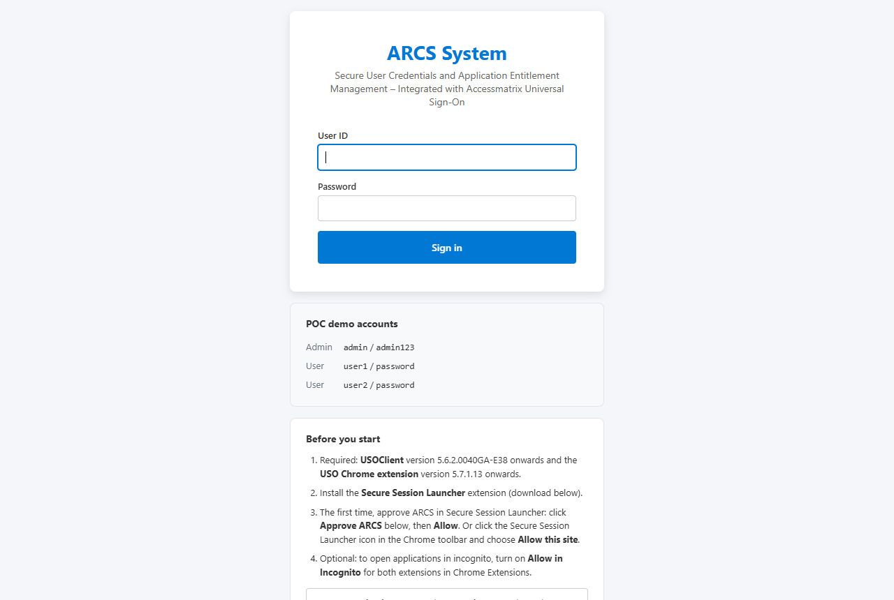
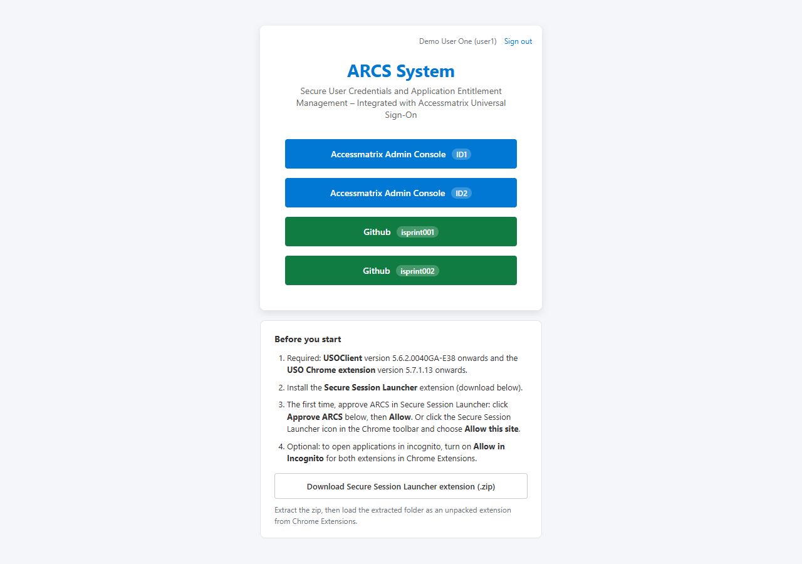
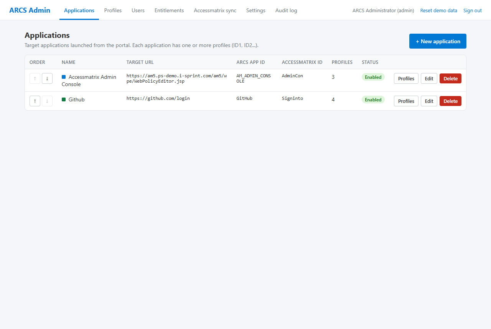
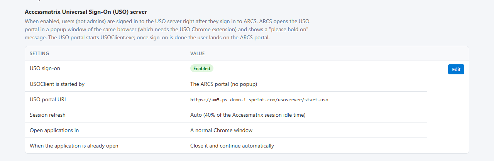

# Example: the ARCS demo, step by step

> Not an official i-Sprint document. See [DISCLAIMER.md](../DISCLAIMER.md).

ARCS is a demonstration web application that implements this guide. While it is online, you can try it at
**https://arcs.ps-demo.i-sprint.com** with the demo user **`user1`**, password **`password`**. It may be reset,
changed or taken offline at any time.

To see USOClient fill the logins, your PC needs USOClient and the USO Chrome extension
([chapter 02](../docs/02-prerequisites.md)), and the Secure Session Launcher extension (downloadable from the
ARCS sign-in page). Without them you can still sign in and see the portal.

## 1. Sign in

The sign-in page lists what is needed under "Before you start". In this demo, ARCS signs the user in to
AccessMatrix itself; in your application, this is where your AccessMatrix sign-in happens (CLP/AMG with your
chosen methods).

## 2. USOClient starts, without a popup

After sign-in, ARCS goes straight to its portal. The demo is set to start USOClient from the portal
([chapter 03](../docs/03-sign-in-to-uso.md), option B): the portal page (`portal.html?webui`) sends USOClient
its settings and the AccessMatrix session, waits until it is ready, then forces an application download
([chapter 04](../docs/04-sync.md)). Until then, the application buttons ask the user to wait.

Each button is one **profile**: an application and an account. `user1` can launch the AccessMatrix Admin
Console as `ID1` or `ID2`, and GitHub as `isprint001` or `isprint002`. The profile names in USO match these
labels.

## 3. Launch an application

Clicking **Github isprint001**:

1. opens ARCS's launch page with a one-use ticket ([chapter 05](../docs/05-launch-with-credentials.md));
2. the ARCS server writes `isprint001`'s login details into `user1`'s USO profile named `isprint001`, and makes
   it the default;
3. the launch page forces a download and selects that profile in USOClient;
4. Secure Session Launcher opens GitHub in its own window, and USOClient fills the login.

## 4. A second account

Clicking **Github isprint002** while the first GitHub window is open: GitHub keeps its sign-in in cookies, so the
demo is set to close the open GitHub window, clear GitHub's sign-in data, and open it again for `isprint002`
([chapter 06](../docs/06-multiple-accounts.md)). With this setting, any application that is already open is
closed and opened again with the new account, the AccessMatrix Admin Console too. With the setting "Ask the user"
instead, the user can choose "Open parallel session" and keep `ID1` and `ID2` side by side; switching between the
windows then switches USOClient's profile.

## 5. Stay signed in

While the portal is open, ARCS refreshes the AccessMatrix session at 40% of its idle time and keeps USOClient's
own session alive ([chapter 07](../docs/07-keep-alive.md)).

## 6. Sign out

**Sign out** signs USOClient out, closes the application windows ARCS opened, and clears their sign-in data
([chapter 08](../docs/08-sign-out.md)).

## How the demo is configured

These screenshots of the demo's administration pages show the settings behind the steps above. (The admin pages
are not open to the public.)

The applications, with the AccessMatrix ESSO application each one maps to:

The USO settings: start USOClient from the portal (no popup), session refresh, window type and already-open
behaviour:

